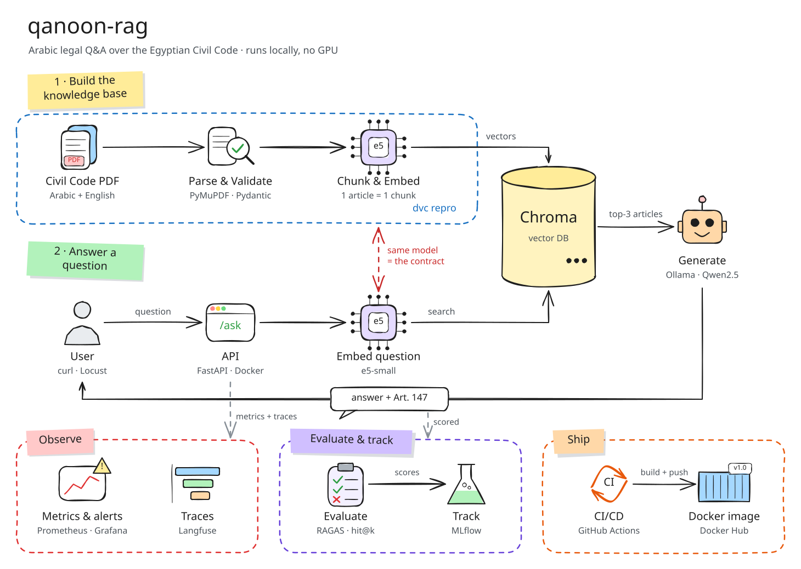

# qanoon-rag

**Ask questions about the Egyptian Civil Code in Arabic or English, and get answers that cite the exact article.**


A retrieval-augmented generation (RAG) system built with MLOps practices. It runs fully on a laptop, with no GPU.

> Final project for the ITI × MLOps MENA "MLOps Practitioner" course, Track B (LLM / RAG).

## Architecture



| Path | When it runs | What it does |
|---|---|---|
| **1. Build the knowledge base** | Offline (`dvc repro`) | Parse the PDF into one record per article, embed it, store it in Chroma |
| **2. Answer a question** | Online, per request | Find the top 3 articles and generate an answer with citations |

Editable diagram: [docs/architecture.excalidraw](docs/architecture.excalidraw)

## Tech stack

| Layer | Tools |
|---|---|
| Data and pipeline | DVC, PyMuPDF, Pydantic |
| Retrieval and generation | multilingual-e5-small, Chroma, Ollama (Qwen2.5) |
| API and packaging | FastAPI, Docker, uv |
| Evaluation and tracking | RAGAS, MLflow |
| CI/CD and monitoring | GitHub Actions, Prometheus, Grafana, Langfuse |

## Getting started

Requires Python 3.11 and [uv](https://docs.astral.sh/uv/).

```bash
git clone https://github.com/hawwari4/qanoon-rag.git
cd qanoon-rag
uv sync
uv run uvicorn qanoon_rag.serving.api:app --reload
```

Open http://localhost:8000/docs. Run the tests with `uv run pytest`.

## Project structure

```text
qanoon-rag/
├── src/qanoon_rag/
│   ├── schemas.py       # Article contract + API models
│   ├── config.py        # settings from environment variables
│   ├── indexing/        # path 1: parse, validate, chunk, embed
│   └── serving/         # path 2: API, retrieve, generate
├── tests/               # pytest suite
├── data/                # corpus and index (tracked by DVC)
├── eval/                # evaluation questions and scoring
├── monitoring/          # Prometheus and Grafana config
└── docs/                # architecture diagram
```

## Data

Egyptian Civil Code (Law No. 131 of 1948), bilingual Arabic/English PDF: [source link](https://sadanykhalifa.com/uploads/Laws/1576751803.pdf). Used for educational purposes. Details in [data/README.md](data/README.md).

## Status

🚧 Work in progress. The architecture and project skeleton are ready; the corpus pipeline is next.

## License

[MIT](LICENSE) · Built by **Abdelrahman Mohamed** ([@hawwari4](https://github.com/hawwari4))
